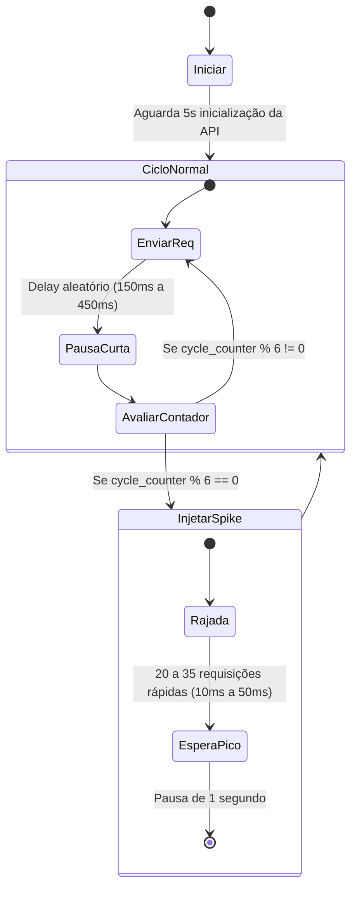

# Worker Gerador Contínuo de Tráfego

Para validar a observabilidade em tempo real sem a necessidade de manter loops interativos de terminal (`while true; do curl...`), foi desenvolvido um worker conteinerizado dedicado (`lab-traffic-generator`).

## 1. Arquitetura do Worker



---

## 2. Código do Worker (`traffic-generator/load_worker.py`)

```python
import time
import random
import requests
import logging
import sys

logging.basicConfig(
    stream=sys.stdout,
    level=logging.INFO,
    format='%(asctime)s [%(levelname)s] [traffic-worker] %(message)s',
    datefmt='%Y-%m-%d %H:%M:%S'
)
logger = logging.getLogger("traffic-worker")

TARGET_URL = "http://custom-api:5000/api/pedidos"

def send_request():
    try:
        res = requests.get(TARGET_URL, timeout=2.0)
        return res.status_code
    except Exception as e:
        logger.warning(f"Falha de conexão com a API: {e}")
        return 0

def run():
    logger.info("Iniciando gerador contínuo de tráfego para a API...")
    cycle_counter = 0

    while True:
        cycle_counter += 1
        
        # A cada 6 iterações, simula um pico de tráfego (spike)
        if cycle_counter % 6 == 0:
            burst_size = random.randint(20, 35)
            logger.info(f">>> [SPIKE DETECTADO] Injetando rajada de {burst_size} requisições rápidas...")
            for _ in range(burst_size):
                send_request()
                time.sleep(random.uniform(0.01, 0.05))
            time.sleep(1.0)
            continue

        # Tráfego regular
        send_request()
        time.sleep(random.uniform(0.15, 0.45))

if __name__ == "__main__":
    time.sleep(5) # Aguarda a estabilização do container da API
    run()
```

---

## 3. Dockerfile do Worker (`traffic-generator/Dockerfile`)

```dockerfile
FROM python:3.11-slim
WORKDIR /app
COPY requirements.txt .
RUN pip install --no-cache-dir -r requirements.txt
COPY load_worker.py .
CMD ["python", "-u", "load_worker.py"]
```
*(O parâmetro `-u` força o Python a não fazer buffer da saída padrão, garantindo que os logs apareçam instantaneamente no `docker compose logs`).*
