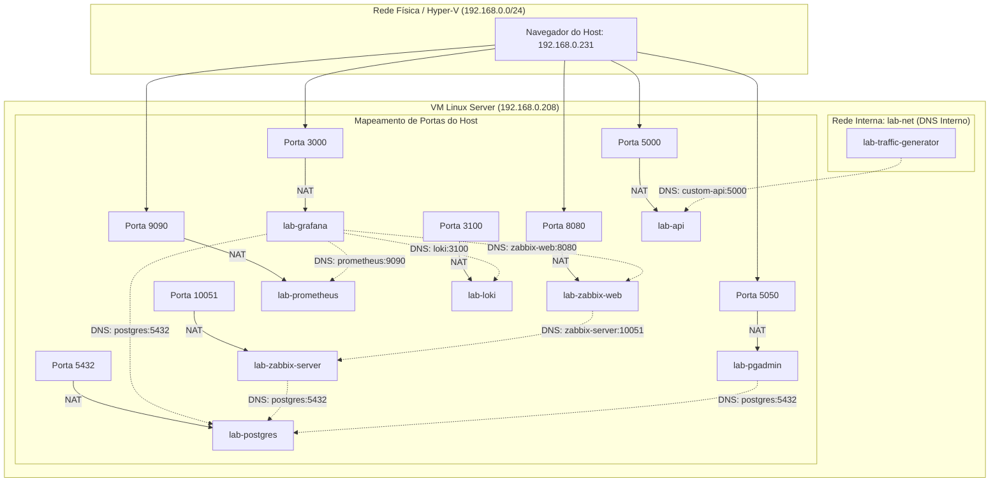

# Topologia de Rede e Portas

## 1. Rede Interna `lab-net` (Docker Bridge)

Todos os containers são conectados à rede Docker tipo bridge nomeada `lab-net`. O Docker possui um servidor DNS interno embutido (`127.0.0.11`) que resolve o **nome do serviço** diretamente para o IP interno do container (faixa `172.18.0.0/16`).

---

## 2. Tabela de Portas e Protocolos

| Serviço | Nome do Container | Porta Externa (Host) | Porta Interna (Container) | Protocolo | Função |
| :--- | :--- | :--- | :--- | :--- | :--- |
| **Grafana** | `lab-grafana` | `3000` | `3000` | HTTP | UI Web e orquestração de painéis |
| **Zabbix Web** | `lab-zabbix-web` | `8080` | `8080` | HTTP | Interface administrativa e `/api_jsonrpc.php` |
| **Zabbix Server**| `lab-zabbix-server` | `10051` | `10051` | TCP | Porta de escuta de agentes e trappers |
| **Prometheus** | `lab-prometheus` | `9090` | `9090` | HTTP | Console Web e endpoint `/api/v1/query` |
| **Loki** | `lab-loki` | `3100` | `3100` | HTTP | Endpoint de push `/loki/api/v1/push` e queries |
| **PostgreSQL** | `lab-postgres` | `5432` | `5432` | TCP | Engine do PostgreSQL para clientes externos |
| **pgAdmin 4** | `lab-pgadmin` | `5050` | `80` | HTTP | Interface gráfica de gestão do banco de dados |
| **Custom API** | `lab-api` | `5000` | `5000` | HTTP | Endpoints `/api/pedidos` e `/metrics` |
| **Worker Carga**| `lab-traffic-generator`| *Nenhuma* | *Nenhuma* | — | Comunicação puramente de saída interna |
