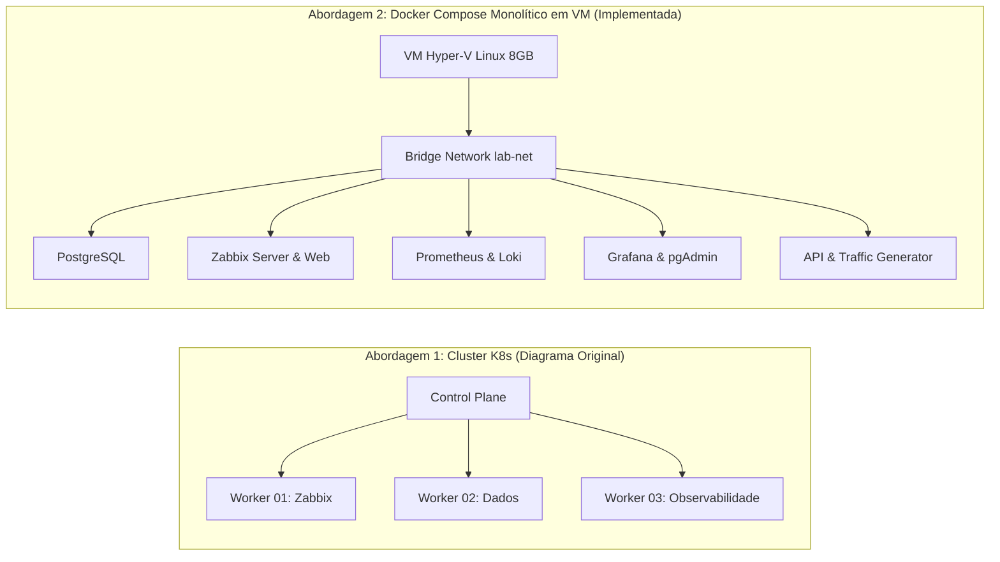

# Arquitetura e Decisões de Engenharia

## 1. Contexto do Problema & Decisão Arquitetural

Durante o ciclo de vida de observabilidade no **Grafana Cloud Free Tier**, os seguintes limites rígidos foram identificados:
* **Retenção temporal:** Máximo de 14 dias para métricas, logs e traces.
* **Volume de ingestão:** Limite rígido de 10.000 séries ativas e 50 GB para logs, traces e perfis.
* **Comportamento em excesso:** O serviço descarta telemetria adicional sem gerar fatura (*usage capped*).

Para sistemas em produção ou laboratórios contínuos de desenvolvimento, duas abordagens foram avaliadas:

### Comparativo de Abordagens

1. **Abordagem Kubernetes multi-node (Diagrama analisado):**
   * *Inviável na VM de 8 GB:* O overhead de componentes como `kubelet`, `containerd`, `etcd`, `kube-apiserver` e Ingress Nginx consumiria entre 4 GB e 5 GB de RAM antes mesmo de iniciar as ferramentas de monitoramento.
2. **Abordagem Docker Compose Unificado (Solução Adotada):**
   * Reduz o consumo do runtime a ~500 MB.
   * Elimina complexidades desnecessárias de CNI e Ingress Controller para ambientes locais.
   * Permite que 8 serviços operem consumindo menos de 4,5 GB de RAM.

---

## 2. Dimensionamento de Memória na VM (8 GB RAM)

| Componente | Memória Reservada / Utilizada | Justificativa |
| :--- | :--- | :--- |
| **Linux OS (Ubuntu Server)** | ~500 MB | Processos do sistema, systemd e kernel |
| **PostgreSQL 16 Alpine** | ~600 MB - 1 GB | Buffer pool para tabelas do Zabbix e da aplicação |
| **Zabbix Server & Web** | ~700 MB | Processamento de pollers, triggers e frontend PHP |
| **Prometheus TSDB** | ~600 MB | Cache TSDB em memória e avaliação de PromQL |
| **Grafana Loki** | ~400 MB | Chunks em sistema de arquivos local (`filesystem`) |
| **Grafana OSS** | ~250 MB | Servidor HTTP e renderização de dashboards |
| **pgAdmin 4** | ~350 MB | Aplicação web Python/Flask com interface gráfica |
| **Custom API + Worker** | ~200 MB | Dois runtimes Python 3.11 ultra-leves |
| **TOTAL ESTIMADO** | **~3,6 GB a 4,4 GB** | **Sobra de ~3,6 GB de RAM para buffer do Hyper-V** |
