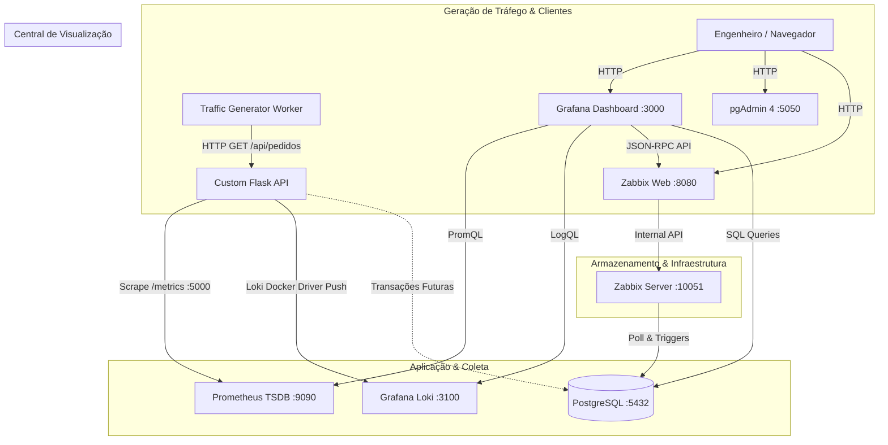

# Bem-vindo à Knowledge Base do Lab Cloud

Esta base de conhecimento documenta a concepção, implementação, operação e solução de incidentes da plataforma de observabilidade do **Lab Cloud**.

O ambiente foi desenvolvido com foco em resolver desafios de observabilidade corporativa em sistemas modernos e legados, unificando os pilares de **Métricas**, **Logs**, **Traces Distribuídos** e **Monitoramento de Infraestrutura**.

## Objetivos Técnicos Alcançados

1. **Eficiência de Recursos:** Execução de 8 containers integrados em uma única máquina virtual com apenas **8 GB de RAM** (alocando cerca de 4 GB reais e reservando 4 GB de buffer).
2. **Independência de Cotas Cloud:** Superação das barreiras do plano gratuito do Grafana Cloud (14 dias de retenção e limite de 50 GB de logs/traces), mantendo dados históricos persistidos localmente.
3. **Análise de APM Real:** Diagnóstico de antipatterns como consultas sequenciais repetitivas (N+1) e tempos mortos (*gaps*) em requisições de sistemas de saúde legados.
4. **Visão Única (*Single Pane of Glass*):** Correlação direta entre picos de latência (Prometheus), falhas HTTP 500 estruturadas (Loki), saúde do sistema operacional (Zabbix) e tabelas transacionais (PostgreSQL).
