# Análise de Traces Distribuídos (APM)

## 1. O que são Traces e Spans?

Enquanto as **Métricas** informam *que* há um problema de latência ou taxa de erro e os **Logs** descrevem *o que* aconteceu em momentos pontuais, o **Distributed Tracing (Rastreamento Distribuído)** mapeia o ciclo de vida de uma requisição de ponta a ponta.

* **Trace:** É a árvore de operações que representa o caminho completo percorrido por uma transação (ex.: da chamada HTTP inicial até as rotas de ORM e commits de banco).
* **Span:** É a unidade fundamental de trabalho. Um span possui timestamp de início, duração, atributos contextuais (tags) e eventos.

---

## 2. Anatomia de uma Requisição (Análise do Caso Real)

Abaixo está a representação conceitual do trace extraído do sistema `PortalSaude` analisado no laboratório:

```mermaid
gantt
    title Anatomia do Trace: POST /CentralMarcacao/atendimento/manutencaoFilaEspera.do (841 ms)
    dateFormat X
    axisFormat %s ms

    section Trace Raiz
    PortalSaude Root Span (HTTP 200 OK)        :active, root, 0, 841

    section Framework Struts
    AllStrutsActionAspect (Action Execution)   :crit, struts, 0, 263

    section Queries Sequenciais (Hibernate)
    HQL_QUERY #1                               :done, h1, 0, 1
    UNIQUE_RESULT #1                           :done, u1, 1, 3
    UNIQUE_RESULT #2 (Gargalo Hibernate)       :done, u2, 10, 51
    LIST #1                                    :done, l1, 55, 61
    LIST #2                                    :done, l2, 65, 68

    section Inatividade / Overhead Interno
    Tempo Morto (CPU Bound / Render / Locks)   :milestone, gap, 263, 841
```

### Diagnósticos Revelados pelo Waterfall Chart:
1. **Serialização de Chamadas de Banco (Antipattern N+1):**
   * Observam-se consultas repetitivas de `HQL_QUERY`, `UNIQUE_RESULT` e `LIST` rodando de forma estritamente sequencial entre `0 ms` e `263 ms`. Esse comportamento degrada a performance do pool de conexões.
2. **Gaps de Tempo (Tempo Morto / Desinstrumentado):**
   * A execução do Struts encerra na marca de `263 ms`, mas a requisição só é devolvida ao cliente aos `841 ms`. Existe um intervalo de quase **578 ms** onde o código da aplicação executa tarefas que não possuem spans associados (processamento de CPU, renderização de JSP/JSON ou disputa de lock de thread).

---

## 3. Estratégia de Otimização: Tail-Based Sampling

Para não saturar cotas de nuvem com dados redundantes de requisições bem-sucedidas:

| Tipo de Tráfego | Regra de Amostragem | Objetivo |
| :--- | :--- | :--- |
| **Requisições com Erro (HTTP 5xx)** | **100% de ingestão** | Garantir captura de stack traces para debugging. |
| **Requisições Lentas (> 500 ms)** | **100% de ingestão** | Capturar anomalias de latência e degradação de BD. |
| **Requisições Rápidas (HTTP 200 OK)**| **5% a 10% (Probabilístico)** | Reduzir o volume de dados em até 90% preservando relevância estatística. |
