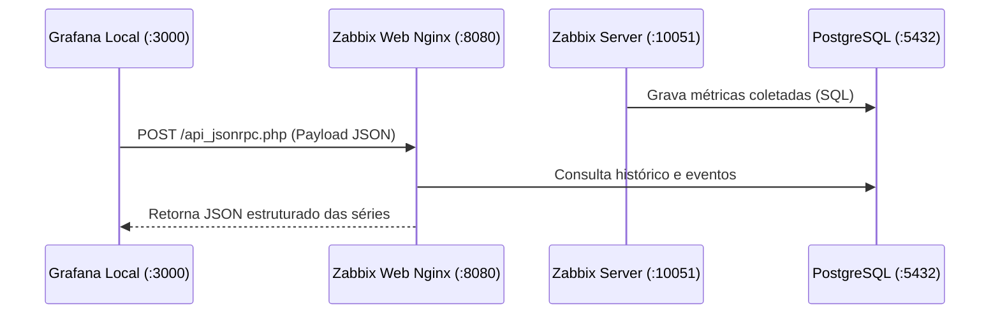

# Monitoramento de Infraestrutura com Zabbix 7

## 1. Papel no Lab Cloud

Enquanto o Prometheus monitora métricas internas da aplicação (Whitebox Monitoring), o **Zabbix** foi integrado para fornecer visibilidade profunda de infraestrutura (Blackbox & System Monitoring):
* Utilização de CPU e Load Average do Host Linux.
* Consumo de memória real, buffers e swap.
* Monitoramento de integridade e pools de conexões do próprio servidor PostgreSQL.

---

## 2. Integração Zabbix-PostgreSQL

O Zabbix Server e o Zabbix Web conectam-se à mesma base de dados PostgreSQL através de variáveis de ambiente gerenciadas no Docker Compose:

* **Serviço Server (`lab-zabbix-server`):** Executa os pollers de coleta e gravação na porta `10051`.
* **Serviço Web (`lab-zabbix-web`):** Provê o frontend em PHP/Nginx na porta `8080` e expõe o endpoint `/api_jsonrpc.php`.



---

## 3. Instalação do Plugin Zabbix no Grafana OSS

Devido a alterações no executável CLI das versões modernas do Grafana, a instalação foi declarada nativamente no `docker-compose.yml`:

```yaml
  grafana:
    image: grafana/grafana-oss:latest
    container_name: lab-grafana
    environment:
      - GF_SECURITY_ADMIN_USER=admin
      - GF_SECURITY_ADMIN_PASSWORD=@Carica98
      - GF_INSTALL_PLUGINS=alexanderzobnin-zabbix-app
```

### Configuração do Data Source no Grafana:
* **HTTP URL:** `http://zabbix-web:8080/api_jsonrpc.php` *(obrigatoriamente apontando para o endpoint da API)*.
* **Username:** `Admin`
* **Password:** `zabbix`
